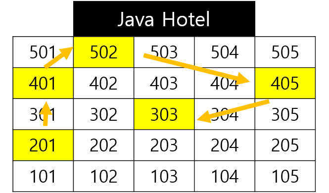

> **이 장에서 배울 내용**
>
> * LinkedList 
> * LinkedList vs ArrayList

<!--more-->

* this unordered seed list will be replaced by the toc
{:toc}

### 시작하기에 앞서
이번 장에서는 LinkedList 연결리스트를 다룰 예정이다. 코딩테스트를 준비하기 위해선 개념 뿐만 아니라 `simple`,`doubly`,`double-ended`,`circular` 와 같이 다양한 형태로 구현하고 사용할 줄 알아야한다.
기존에 [ArrayList를 정리해보았으니](https://hye807n.github.io/studylog/ArrayList.html) 장단점을 비교해보며 어느 상황에서 사용해야 유리할지 고민해보았다.

<br/>
<br/>
<br/>

### ArrayList 문제점
`ArrayList`는 동적 배열로 데이터의 수정/삭제 작업 시에 할당한 공간이 꽉 차면 기존의 공간에 50% 씩 메모리를 재할당 시켜주며 요소 중간에 데이터를 추가할 경우에는 기존의 배열을 복사하여 뒤로 한칸씩 *일일히 이동*해야한다. 이는 성능 저하의 원인이 되며 삽입/삭제가 빈번하게 발생할수록 메모리 공간 낭비 및 성능의 치명적인 문제가 된다.
이러한 단점을 극복하기 위해 고안된 것이 `LinkedList`이다.

<br/>
<br/>

# LinkedList
***

<br/>

`LinkedList`은 `ArrayList`처럼 데이터의 삽입/삭제가 가능한 자료구조라는 점에서는 동일하지만 내부적인 구조는 아주 다르다. `ArrayList`의 경우 연속적인 데이터로 구성된 배열 형태이지만 `LinkedList`는 각 **노드** 와 주소를 가리키는 **간선(pointer)** 으로 연결된 형태로 구성되어 있다.
현재 노드에는 현재 노드의 주소와 데이터(data), 그리고 다음 노드의 주소(pointer)를 통해 연결되어있다. 예시 사진의 노드 주소에서도 볼 수 있듯이 각 노드는 메모리에 연속적으로 공간을 할당받지 않는다. 노드와 포인터를 동해 동적으로 크기가 조절될 수 있다.
사진은 `LinkedList`의 가장 기본적인 개념을 위한 형태(simple)이고, doubly, double-ended, circular 등의 다양한 형태가 있는데 아래에서 다뤄보겠다.

<br/>
<br/>

> 
> - **Array**
> 처음 이 구조에 대해 이해하는 것에 도움이 되었던 예시를 가지고 와보자면, Java Hotel이 있다고 쳐보자. 
> `Array`와 `ArrayList`는 101호부터 4 개의 방을 예약하고 싶다고 했을 때, **순차적으로 101호부터 일렬로 104 호까지 예약이 가능한 구조**이다. 
> 다만, **`Array`는 사전예약한 만큼의 방만 사용이 가능**하고 예약 후에 추가로 방의 예약을 취소하거나 더 예약할 수 없지만 **`ArrayList`는 예약 후에도 104 호의 예약을 취소하거나, 105호를 추가로 예약**할 수도 있는 정도의 차이는 있다. 그리고 각 방에서 자기 다음 방은 바로 옆 방 객실이 된다.
> <br/>
> 
> - **LinkedList**
> `LinkedList`의 경우에는 순차적인 배열로 구성되어있지 않고 각 방(노드)는 간선(포인터)로 연결이 되어있다. 그래서 4 개의 방을 예약했을 때 각 방은 연속적으로 예약되지 않으며 **각 방은 다음 방으로 가기위한 포탈로 연결**되어있다. 사진을 기준으로 보면, 201 호에는 다음 방인 502 호로 가는 포탈이, 502 호에는 405 호로 가는 포탈이... 차례대로 303 호까지 이어질 것이다. 
> <br/> 
> 
> - **LinkedList - 추가**
> 만약 201 호와 502 호 사이에 401 호를 추가로 예약하고 싶다면 **201 호에서 포탈을 401 호로 연결**해주고, **401 호에서 포탈을 502 호로 연결**해주면 된다.
> <br/>
> 
> - **LinkedList - 삭제**
> 502 호의 예약을 취소하고 싶다면 **502 호에서 405호로 이어진 포탈을 삭제**한다. 그 다음 **401호에서 502 호로 가던 포탈을 405 호로 이동하도록 연결**하면 502 호의 예약을 취소한 것이다.

<br/>
<br/>

# LinkedList 종류
***
<br/>

- ### simple/singly(단방향 연결리스트)
  

  <br/>

  > ``` java
  > class LinkedList {
  >   Node head;  // 헤드 노드 주소 필드
  >   Node tali;  // 꼬리 노드 주소 필드
  > }
  > class Node {
  >   Node next;  // 다음 노드 주소 필드 
  >   int data;   // 현재 노드 데이터 필드
  >   ...
  > }
  > ```
  > <br/>
  > 
  > 1. **노드(node)**: 각 데이터와 다음 노드를 가리키는 간선(포인터/링크)로 구성되어있다.
  > 2. **데이터(data)**: 각 노드가 저장한 객체/값이다.
  > 3. **포인터(next)**: 각 노드가 다음 노드를 가리키는 포인터 링크를 가지고 있다.
  > 4. **헤드(head)**: `LinkedList`의 첫 번째 노드인 시작 노드를 가리키는 포인터이다.
  > 5. **꼬리(tail)**: `LinkedList`의 마지막 요소이다. 다음 노드의 주소 정보는 `null`로 저장한다.

  단방향 연결리스트는 가장 기본적인 형태로,  `head`를 시작 노드로 하여 각 노드마다 `next` 주소를 통해 연결되어있다. 마지막 노드인 `tail`의 `next` 주소는 `null`로 하여 단방향으로 연결되어있다. 하지만 단방향으로 연결되어있어서 **현재 노드를 기준으로 이전 요소로 접근해야할 때 부적합한 특징**이 있다.
  만약 저장된 데이터가 10 개인데 마지막 노드에 접근하기 위해서는 `head`로 시작하여 `tail`까지 **10 번 이동**해야하기 때문이다. 이를 극복한 것이 `doubly` linked list이다.

    <br/>
    <br/>    

    - #### simple/singly(단방향 연결리스트) - 추가

        **case1. 중간 삽입** 
        
        기존에 `head` 노드인 `data1`에서 `next`로 `data2` 로 연결되어있던 구조 사이에 `data3`을 추가하고 싶다고 한다고 가정해보겠다.

        > 1. 추가할 `data3`을 담을 `node`생성
        > 2. `head`로부터 데이터 추가 위치 직전까지 순회
        > 3. (추가 직전노드인)`head`의 `next`를 `data3`으로 수정
        > 4. `data3`의 `next`를 `data2`로 수정

        <br/>

        **case2. 처음(head) 삽입**
        
        
        추가할 `data3`를 가장 처음에 추가하고 싶은 경우에는 `head`를 `data1`에서 변경해야한다.
        > 1. 추가할 `data3`을 담을 `node`생성
        > 2. `data3`의 `next`를 `data1` 로 설정
        > 3. `LinkedList`의 `head`를 `data3`으로 설정

        <br/>

        **case3. 마지막(tail) 삽입**
        
        > 1. 추가할 `data3`를 담을 `node`생성
        > 2. `head`로 부터 `tail`까지 순회
        > 3. `data2`의 `next`를 `data3`로 수정
        > 4. `data3`의 `next`를 `null`로 설정

        <br/>

    - #### simple/singly(단방향 연결리스트) - 삭제
        **case1. 처음(head) 삭제**
        > 1. `LinkedList`의 `head`를 `data2`로 변경
        > 2. 기존 `data1` 객체 삭제

        <br/>

        **case2. 마지막(tail) 삭제**
        > 1. 마지막(tail) 직전 객체까지 순회
        > 2. 마지막(tail) 직전 객체인 `data2`의 `next`를 `null`로 변경
        > 3. `data3` 객체 삭제

        <br/>

        **case3. 중간 삭제**
        > 1. 삭제 직전 객체까지 순회
        > 2. 삭제 직전 객체(`data1`)의 `next`를 삭제 다음 객체인 `data3`로 수정
        > 3. 삭제할 객체인 `data2` 객체 삭제

<br/>

- ### doubly(이중 연결리스트)
  
  <br/>

  > ``` java
  > class DoublyLinkedList {
  > Node head;  
  > ...
  > }
  > class Node {
  > Node next;
  > Node prev;  // 이전 노드 주소를 저장하는 필드
  > int data;  
  > ...
  > }
  > ```
  > <br/>
  >
  > 1. **이전 노드(prev)**: 현재 노드를 기준으로 이전 노드 주소를 가리키는 포인터이다.


  이제 어느 정도 연결리스트에 대한 개념이 잡혔을 거라고 가정하고 중복된 설명은 생략하여 정리했다.
  이중 연결리스트는 다음 노드 주소인 `next`뿐만 아니라 **이전 노드 주소를 담고 있는 필드 `prev`가 추가된 형태**이다. 접근하려는 노드가 앞쪽/뒷쪽인지가 따라서 `next` 정보로 순방향(forward) 탐색하거나, `prev` 정보로 역방향(backward) 탐색을 수행한다.
  예를 들어 10 개의 요소가 있는 `linkedlist`에서 9 번째 요소에 접근해야 할 경우를 보자. 단방향 연결리스트(`singly linked list`)는 `head`부터 순차적으로 접근하여 9 번의 이동을 해야한다. 하지만 **이중 연결리스트(`doubly linked list`)의 경우에는 `tail`을 시작으로 `prev` 정보를 통한 역행이 가능**하므로 2 번의 이동으로 접근 가능한 것이다. 따라서 `singly`보다 각 요소에 대한 접근이 쉬워서 기본적으로 많이 사용된다.

  > :sparkles: 실제로 Java Collections 의 LinkedList는 doubly 형태로 구현되어있다.
    
    <br/>
    <br/>

   - #### doubly(이중 연결리스트) - 추가
        **case1. 처음/마지막(head/tail) 추가** 
        
        > 1. 추가할 `node` 생성
        > 2. `head`의 `next`/`prev`를 new `node`로 수정
        > 3. 추가한 `node`의 `next`/`prev`를 기존의 `node`와 연결


        <br/>

        **case2. 중간 추가**
        
        > 1. 추가할 `node` 생성
        > 2. `next`/`prev`를 통해 추가할 위치 직전까지 순회
        > 3. 직전 `node`의 `next`를 새롭게 추가한 `node`로 수정
        > 4. 직후 `node`의 `prev`를 새롭게 추가한 `node`로 수정
        > 5. 추가한 `node`의 `prev`, `next`를 기존의 노드로 설정

    <br/>

    - #### doubly(이중 연결리스트) - 삭제
        **case1. 처음/마지막(next/prev) 삭제**
        
        > 1. `head`의 `next`/`prev`를 삭제할 노드의 다음을 가르키도록 수정
        > 2. 새로 가르킨 노드의 `prev`/`next`를 `null`로 수정
        
        <br/>

        **case2. 중간 삭제**
        
        > 1. 삭제할 `node`로 순회
        > 2. 삭제할 `node`의 `prev`를 통해 이전 노드로 순회
        > 3. 이전 노드의 `next`를 삭제할 `node`의 `next`로 수정
        > 4. 삭제할 `node`의 `next`를 통해 다음 노드로 순회
        > 5. 다음 노드의 `prev`를 삭제할 `node`의 `prev`로 수정

<br/>

- ### double-ended(이중 말단 연결리스트)
  
  <br/>

  > ``` java
  > class doubleEndedLinkedList {
  > Head head; // head class
  > ...  
  > }
  > class Head {
  > Node next;  // 첫 번째 노드 주소 필드
  > Node last;  // 마지막 노드 주소 필드
  > ... 
  > }
  > class Node {
  > int data;
  > Node next;
  > ... 
  > }
  > ```
  > <br/>
  >
  > 1. **`class Head`**: 기존의 `node` class 와는 달리 첫번째 `node`와 마지막`node`의 주소를 가진 별도의 class
  > 2. **Head.next**: 첫 번째 `node` 주소
  > 3. **Head.last**: 마지막 `node` 주소

  이중 말단 연결리스트는 이중 연결리스트와는 다르게 **말단** 부분의 Node의 위치에 접근할 수 있는 자료구조이다. `head`를 통해 마지막 `node`로 바로 접근 가능하다. 이를 위해 **`head`는 기존의 `node` 클래스를 사용하는것이 아닌 별도의 class 를 생성하여 아닌 마지막 노드 `last`의 위치 정보를 가지는 필드를 가지고 있다.** 
  
  <br/>
  <br/>
  
  > **:bulb: `doubly linked list` :left_right_arrow: `double-ended linked list` 뭐가 다르지?**
  > <br/>
  > 둘의 네이밍이 매우 흡사해서 두 개를 동시에 학습하려니 굉장히 헷갈렸다. `double linked list`에 대한 자료는 많이 나왔지만, `double-ended linked list`는 비교적 적었고 이 둘의 개념에 대한 설명 역시 유사했다. 둘 다 `head`에서 `tail`을 가리키고 있다는 점도 같다.
  > 생각보다 간단했는데, 설명을 위해 *이중 말단(double-ended)* 과 *이중 연결(doubly)* 로 언급하겠다. 우선 각각의 `node`의 구조를 보면 이중 말단은 `next` 필드만 있고 이중 연결은 `prev` 까지 있다. 그 이유는 **이중 말단은 `next`(순방향)으로만 향하는 단방향이고 이중 연결은 `next`(순방향), `prev`(역방향) 모두 가능하기 때문**이다.
  > 그런데 이중 말단은 `head`가 별도의 class를 통하여 `next`(시작), `last`(마지막) `node` 를 가지고 있고, 이중 연결은 일반 `node`처럼 `next`(시작) 주소와 `prev`(이전) 주소를 가지고 있다. 
  > 이중 말단은 순방향이니 `tail`(마지막)에서 역방향으로 가지 않는다. 그래서 `prev` 필드가 없고, `head`에서 `tail` `node`를 가지고 있지 않았다면 순방향으로 마지막 `node`가 나올 떄까지 순회해야한다. 이런 상황 때문에 `next` 정보만 갖고있는 일반 `node` 형태가 아닌 별도의 class를 작성한다. 상황에 따라 마지막 `node`에 바로 접근할 수 있도록 말이다.
  > 반면 이중 연결은 여기서 더 나아가 `tail`에서부터 `next` 까지도 중간에 `node`까지 역방향으로 순회할 수 있다. 그래서 `prev` 필드를 추가한 `node` 형태이고, 어차피 `head` 역시 일반 `node`와 같은 형태로 `next`(처음)/`prev`(마지막) `node` 위치만 알면 연결된다.
  > 간단히 정리해서 **이중 말단은 마지막 노드만, 이중 연결은 마지막 노드에서부터 역방향으로 모든 노드를 순회할 수 있다.** 
  

  


<br/>


<br/>
<br/>
<br/>


### 결론
***


<br/>
<br/>
<br/>

[참고자료]<br/>
- [🧱 자바 LinkedList 구조 & 사용법 - 정복하기](https://inpa.tistory.com/entry/JAVA-☕-LinkedList-구조-사용법-완벽-정복하기)
- [[자료구조 | Java] LinkedList(연결 리스트) 이론 및 구현](https://cdragon.tistory.com/entry/%EC%9E%90%EB%A3%8C%EA%B5%AC%EC%A1%B0-LinkedList%EC%97%B0%EA%B2%B0-%EB%A6%AC%EC%8A%A4%ED%8A%B8)
- [java.util.LinkedList 주요 메소드 [1/1]](https://codevang.tistory.com/131)
- [[JAVA] LinkedList의 개념 및 사용법](https://crazykim2.tistory.com/566)
- [[자료구조] 연결 리스트(LinkedList) 자료구조 알아보기 & Java 예제 코드](https://hoehen-flug.tistory.com/29)
- [ArrayList와 LinkedList의 차이](https://dev-coco.tistory.com/19#)
- [🧱 ArrayList vs LinkedList 특징 & 성능 비교](https://inpa.tistory.com/entry/JCF-🧱-ArrayList-vs-LinkedList-특징-성능-비교)
- [[Java] ArrayList vs LinkedList](https://velog.io/@eunbileeme/Java-ArrayList-vs-LinkedList)
- [[java 기초] LinkedList - 단방향](https://velog.io/@dkwktm45/java-%EA%B8%B0%EC%B4%88-LinkedList-%EB%8B%A8%EB%B0%A9%ED%96%A5)
- [[자료구조 Java] 이중 연결리스트(Doubly Linked List) 핵심 정리](https://you88.tistory.com/27)
- [이중 연결 리스트(doubly linked list)](https://blog.naver.com/simjunbo/220023355370)
- [이중 말단 연결 리스트(double ended linked list)](https://blog.naver.com/simjunbo/220023164789)